<div align="center">

# ♻️ SYMBIO

### One Industry’s Waste. Another Industry’s Wealth.

**An industrial by-product exchange that connects surplus materials to their next useful life.**

Discover compatible partners. Understand the match. Negotiate the exchange. Measure the reuse.

[](https://symbio-eight.vercel.app/)
[](https://github.com/Manan-2007/Symbio)


**7 material categories · 15 catalogue materials · 10 fictional companies · worldwide location search**

[The idea](#the-idea) · [Four standout features](#four-standout-features) · [Screenshots](#screenshots) · [Feature tour](#everything-else-built-around-the-exchange) · [Architecture](#architecture) · [Run locally](#run-locally)

</div>

---

## The idea

A furniture workshop has sawdust it needs to clear. A mushroom farm needs growing substrate. A garment factory has cotton offcuts. An insulation maker needs fibre. The material already has another use; the missing connection is between the businesses.

**SYMBIO makes that connection visible and actionable.** Waste generators publish by-products with quantity, price and quality information. Material consumers describe what they need The platform finds compatible pairs, explains their fit, and carries the exchange through negotiation, dispatch, receipt and impact reporting.

| For generators | For consumers | For the circular economy |
| :--- | :--- | :--- |
| Find a use for industrial surplus and explore an alternative to disposal. | Discover secondary raw materials that fit material, quality, distance and budget needs. | Track material kept in use through completed exchanges. |

> [!NOTE]
> **This is a working demonstration platform.** Companies, listings, reviews, testimonials and historical exchanges are fictional. Accounts and marketplace state live in each browser’s `localStorage`. Payments and verification are simulated; carbon figures are illustrative estimates

## Four standout features

### 01 · Explainable, two-way industrial matching and checks two-way alignment

SYMBIO ranks both **supply for a buyer’s requirements** and **buyers for a supplier’s listing**. Each result includes a score, a factor breakdown, plain-language reasons and cautions.

- **Check suitability first:** closed records, self-matches, incompatible materials, insufficient quality, excess contamination or moisture, and locations beyond the buyer’s radius are rejected before ranking.
- **Recognise selected substitutes:** the catalogue defines partial compatibility between specific materials, such as sawdust and wood chips.
- **Explain trade-offs:** partial quantities and prices above budget lower the score, with cautions that support negotiation.
- **Show why alternatives disappeared:** the matching view exposes rejection reasons alongside eligible opportunities.

The matching engine is deterministic TypeScript. It works without AI credentials, and its decisions can be inspected in [matchingEngine.ts](src/services/matchingEngine.ts).

### 02 · AI-assisted material discovery

The **Waste Classifier** and **Symbio Assistant** help users move from “What do I have?” to “Who could use it?”

- Upload a material photograph for an Azure OpenAI vision suggestion, confidence score and visible-quality notes.
- Confirm the suggested material before using the catalogue’s reuse routes, buyer industries and quality checks.
- Ask the assistant about materials, potential uses and next steps inside SYMBIO; requests include catalogue knowledge and a current marketplace snapshot.
- Continue exploring without credentials: manual material selection and clearly identified, rule-based catalogue answers remain available.

Photos are resized in the browser. Clicking **Analyse photo** sends the resized image through the application’s server to Azure OpenAI. The classifier does not fabricate results when the service is unavailable.

### 03 · Upcycling yield & non-cash barter estimation

The **Upcycling & Barter Estimator** explores what a receiver could make from a by-product and what it could return to the supplier through **Material Value Equivalency (MVE)**.

| Output | What it explains |
| :--- | :--- |
| Process classification | Whether the transformation is additive, subtractive or hybrid, with process mechanics. |
| Yield model | A formula, named variables, baseline input/output mass and a batch-size slider. |
| MVE valuation | Supplier disposal offset (`Do`), receiver virgin-material offset (`Vo`) and processing cost (`Pc`) in non-fiat value units. |
| Proposed exchange | Goods or services returned to the supplier, a trade ratio and an arithmetic balance check. |
| Risks & mitigations | Technical or logistical bottlenecks and proposed ways to address them. |

Start with a built-in example—sawdust to mushroom substrate, cotton scraps to insulation, PET flakes to trays, or steel turnings to castings—or open the estimator with details prefilled from a match. A copyable summary makes an estimate easy to review.

**These are AI-generated hypothetical estimates, not validated process designs or executed barter contracts.** Batch scaling assumes linear yields and values. Result parsing and balance arithmetic live in [barter.ts](src/services/barter.ts).

### 04 · Impact tied to completed exchanges

SYMBIO connects its environmental dashboard to the exchange lifecycle. **A request, negotiation or shipment in transit contributes zero recorded reuse.** Only a completed exchange contributes its agreed quantity.

```text
Estimated avoided CO₂e = completed reused mass × material-specific demo factor
```

The dashboard includes reused kilograms, landfill diversion, estimated avoided CO₂e, completed exchange counts, monthly charts, category shares and company-level statistics. Users can switch between all companies and their own company, and inspect the material factors in the methodology table.

For example, **400 kg of sawdust × 0.4 = 160 kgCO₂e** under the demo’s invented sawdust factor. This illustrates the calculation; it is not a certified carbon offset or credit. See [carbonCalculator.ts](src/services/carbonCalculator.ts).

## Screenshots

Actual captures of the [deployed application](https://symbio-eight.vercel.app/), taken on **2 November 2026** across desktop and narrow-screen layouts. Click an image to inspect it at full resolution. All figures shown are demo data.

<table>
  <tr>
    <td width="50%" valign="top" align="center">
      <strong>Exchange dashboard</strong><br />
      <sub>Activity, completed reuse, matches and charts in the updated layout.</sub><br /><br />
      <a href="docs/screenshots/showcase/07-dashboard.jpg">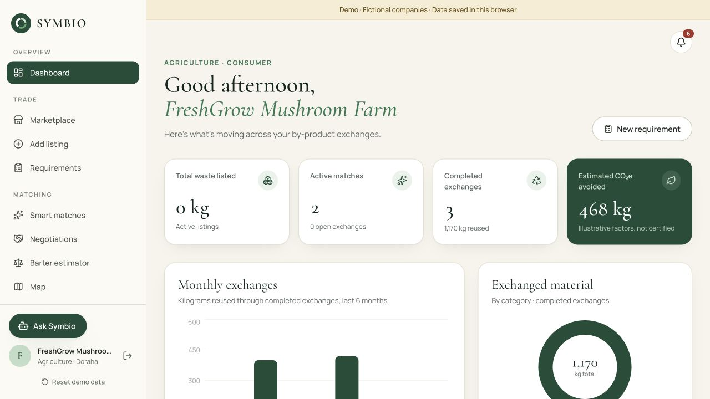</a>
    </td>
    <td width="50%" valign="top" align="center">
      <strong>Worldwide location search</strong><br />
      <sub>London selected as the map origin through Geoapify place search.</sub><br /><br />
      <a href="docs/screenshots/showcase/08-worldwide-map.jpg">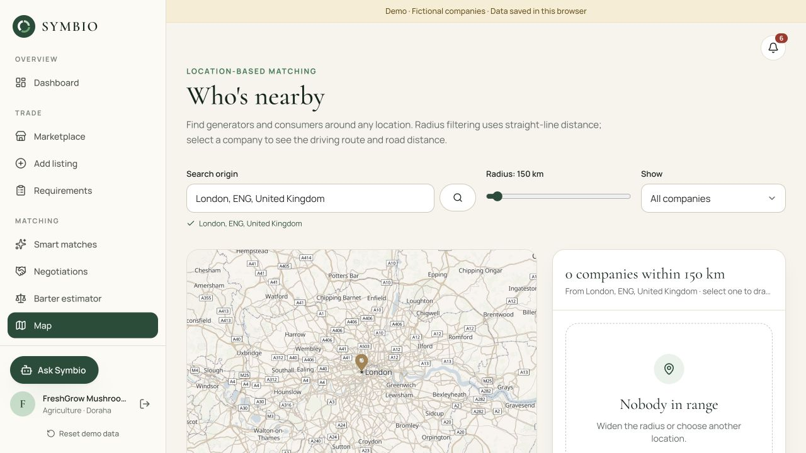</a>
    </td>
  </tr>
  <tr>
    <td width="50%" valign="top" align="center">
      <strong>Explainable smart matches</strong><br />
      <sub>A ranked recommendation with the complete score breakdown.</sub><br /><br />
      <a href="docs/screenshots/showcase/02-smart-matches.png">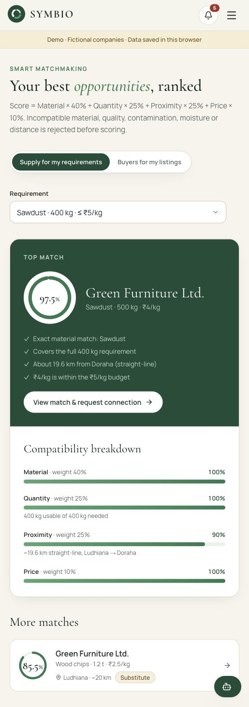</a>
    </td>
    <td width="50%" valign="top" align="center">
      <strong>Upcycling & barter workspace</strong><br />
      <sub>Supplier, receiver and batch inputs, with reusable examples.</sub><br /><br />
      <a href="docs/screenshots/showcase/06-barter.png">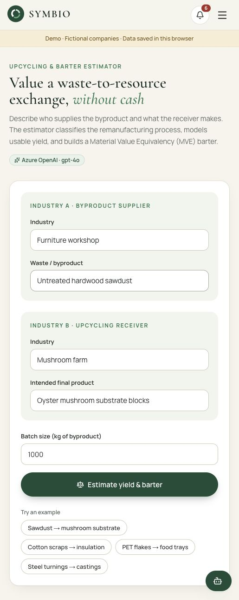</a>
    </td>
  </tr>
  <tr>
    <td valign="top" align="center">
      <strong>The circular-economy landing page</strong><br /><br />
      <a href="docs/screenshots/showcase/01-home.png">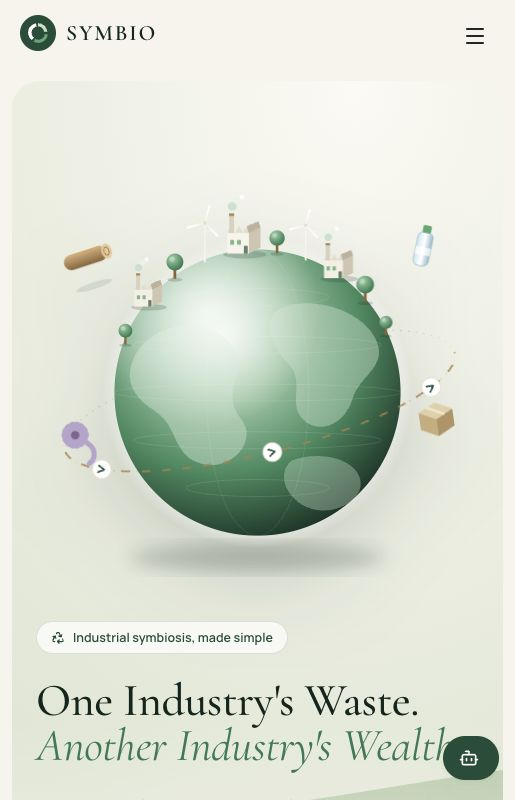</a>
    </td>
    <td valign="top" align="center">
      <strong>Material marketplace</strong><br /><br />
      <a href="docs/screenshots/showcase/03-marketplace.png">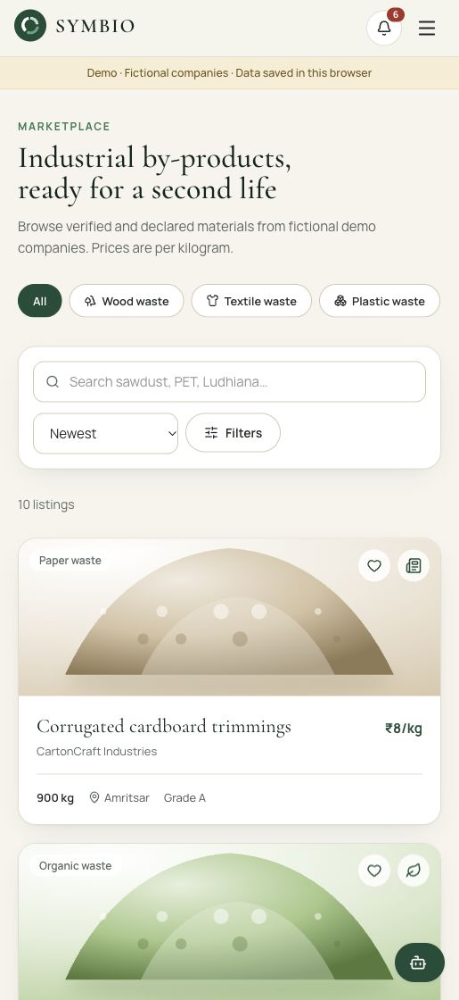</a>
    </td>
  </tr>
  <tr>
    <td valign="top" align="center">
      <strong>Completed-exchange impact</strong><br /><br />
      <a href="docs/screenshots/showcase/04-impact.png">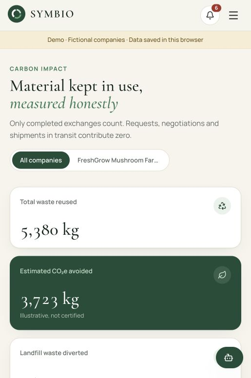</a>
    </td>
    <td valign="top" align="center">
      <strong>Monthly environmental trends</strong><br /><br />
      <a href="docs/screenshots/showcase/05-impact-charts.png">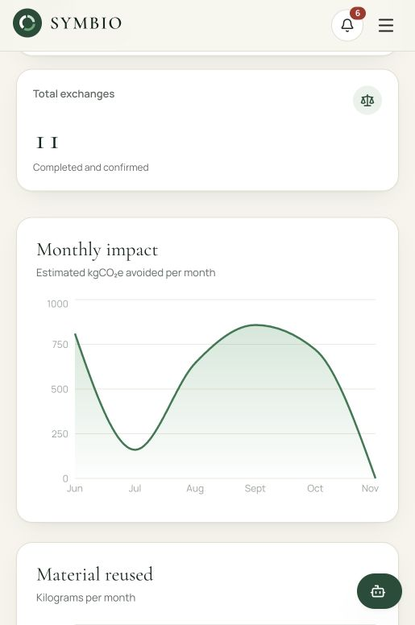</a>
    </td>
  </tr>
</table>

> **Screenshot context:** The original narrow-screen captures predate integration setup. The barter screenshot shows the input workflow, not a generated result. The new dashboard and London map captures show the updated production deployment.

## Everything else built around the exchange

| Area | Included capabilities |
| :--- | :--- |
| **Landing & discovery** | Illustrated globe, animated statistics, four-step walkthrough, generator/consumer sections, category browsing, a real computed sample match, featured listings and labelled fictional testimonials. |
| **Company onboarding** | Registration, email/password sign-in, instant demo-company access, generator/consumer/both roles, worldwide location search, company profile setup and editable profile details. |
| **Dashboard** | Active listing mass, recommended matches, open and completed exchanges, estimated CO₂e, monthly exchange charts, category breakdown, activity and shortcuts. |
| **Marketplace** | Search across materials, companies and locations; seven category filters; location, minimum quantity and maximum price filters; saved listings; newest, price and quantity sorting. |
| **Listing details** | Material specifications, reuse routes, supplier details, quality grade, moisture, contamination, availability, saved items and contact-seller requests. |
| **Listing creation** | Kilogram/tonne quantities, INR-per-kilogram pricing, images resized in-browser, quality and availability declarations, and active/closed listing controls. |
| **Buyer requirements** | Required material and quantity, budget, search radius, minimum grade, maximum moisture/contamination, delivery preference, notes and open/closed controls. |
| **Negotiations** | Purchase requests, counter-offers, quantity/price changes, messages, accept/decline/withdraw actions, status history and buyer/seller-specific workflow checks. |
| **Simulated escrow** | UPI, net banking, card and NEFT choices; payment reference; held, released and refunded states. No money moves and no payment credentials are collected. |
| **Nearby companies** | Search any location worldwide, filter companies by radius and role, view a schematic fallback map, and use Geoapify static maps, driving distance, travel time and route rendering. |
| **Company profiles** | Business information, listings, fictional reviews, trust score and verification badges. GSTIN format checking and simulated review retain only the document filename. |
| **Notifications** | In-app activity-derived notifications for exchanges, offers, messages, payment events, verification and matching, with read-state tracking. |
| **Transaction history** | Search and status filters, agreed quantities and amounts, payment references/status, completed value and CSV export. |
| **Integration visibility** | A dedicated settings page backed by `/api/status`; reports configuration without returning secret key values. |
| **Storage resilience** | Versioned state validation, hydration-aware persistence, visible storage failures, preservation of corrupt/unsupported data and a targeted demo reset. |
| **Interface polish** | Forest-green and warm-ivory theme, serif headings, reusable cards and forms, motion, responsive navigation, focus indicators, reduced-motion support, modals and toasts. |
| **Supporting pages** | About, local-only contact form, simulated password-reset flow and the preserved original prototype. |

### Supported material streams

| Category | Catalogue materials | Example second lives |
| :--- | :--- | :--- |
| 🌳 Wood | Sawdust, wood chips, pallet wood offcuts | Mushroom substrate, boards, pellets, mulch, furniture |
| 🧵 Textile | Cotton scraps, polyester offcuts | Recycled yarn, insulation, filling, acoustic panels |
| 📦 Plastic | PET flakes, HDPE regrind, LDPE film scrap | Packaging, strapping, pipes, crates, plastic lumber |
| ⚙️ Metal | Steel turnings, aluminium offcuts | Re-melting, briquetting, secondary aluminium, die casting |
| 🌱 Organic | Coffee grounds, food-processing residue | Compost, mushroom substrate, biogas |
| 📄 Paper | Cardboard offcuts, paper trimmings | Recycled pulp, void fill, moulded pulp, insulation |
| 🏗️ Construction | Concrete rubble | Road sub-base, recycled aggregate, fill |

The fictional companies are seeded in Ludhiana, Doraha, Chandigarh, Mohali, Jalandhar, Amritsar, Patiala, Mandi Gobindgarh, Panipat and New Delhi. New companies, listings and requirements can use a place selected from worldwide Geoapify search; those coordinates travel with the saved record. A location need not have an active demo listing.

## From surplus to second life

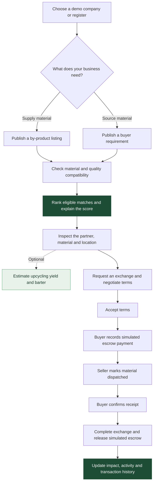

### How the match score works

After the hard eligibility checks, each factor is normalised to `0–1`:

```text
Score (%) = 100 × (0.40 × M + 0.25 × Q + 0.25 × D + 0.10 × P)
```

| Factor | Weight | Calculation |
| :--- | :---: | :--- |
| `M` — material compatibility | 40% | `1` for an exact material; a catalogue-defined fraction for an accepted substitute. |
| `Q` — quantity coverage | 25% | `min(available kg, required kg) / required kg`. |
| `D` — proximity | 25% | `max(0, 1 − straight-line distance / buyer radius)`. |
| `P` — price compatibility | 10% | `1` when at or below budget; otherwise `max(0, 1 − (price − budget) / budget)`. An over-budget price with zero budget scores `0`. |

**Worked demo:** Green Furniture offers 500 kg of sawdust at ₹4/kg in Ludhiana. FreshGrow needs 400 kg at up to ₹5/kg in Doraha, with a 195 km radius. At approximately 19.6 km straight-line distance, `M = 1`, `Q = 1`, `D ≈ 0.90`, and `P = 1`, giving **97.5%** after rounding to one decimal.

Ties are resolved by distance, then stable match ID. Radius filtering uses the Haversine formula with selected place coordinates; original demo companies use approximate seeded city centres. Geoapify road distances are separate and do not change the matching score.

### Exchange lifecycle

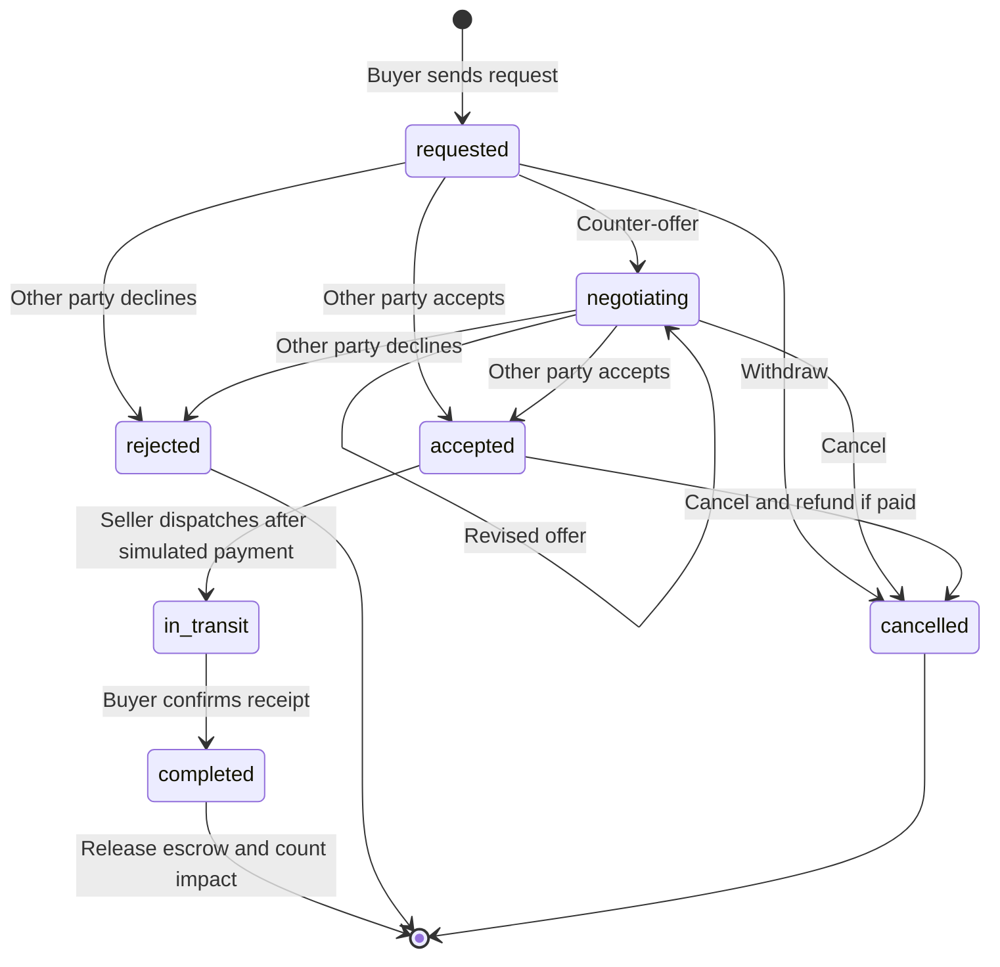

Messages, offers and status events belong to the deal record. Payment is a separate nested state—`held_in_escrow`, `released` or `refunded`—rather than an additional deal status.

## Architecture

SYMBIO is a **Next.js App Router application with browser-local domain state and server-side integration adapters**. It does not currently have a shared application database.

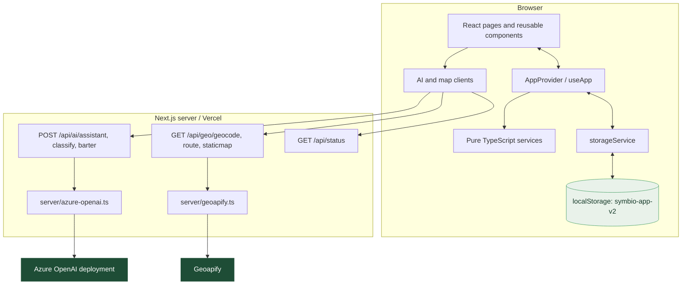

### Design decisions

| Decision | Why it matters |
| :--- | :--- |
| **One application state owner** | `AppProvider` manages hydration, the active company, persisted state and actions; views derive their data from the same state. |
| **Framework-independent domain logic** | Matching, validation, carbon arithmetic, analytics and transitions live in `src/services/`, making the rules directly testable. |
| **Validated state transitions** | Actions check inputs, participants and deal status against the latest state before committing. |
| **Persistence behind an adapter** | `storageService.ts` isolates load/save/reset; a future shared backend can replace this boundary alongside the action layer. |
| **Server-side external credentials** | Azure OpenAI and Geoapify keys are read only in server modules and used through route handlers. |
| **Explicit fallback behaviour** | The core exchange works without external credentials; the assistant uses catalogue answers, the map has a schematic fallback, and AI analysis reports unavailability. |
| **Separate original prototype** | `/prototype` uses `src/lib/`, `DemoProvider` and `symbio-demo-v1`; it does not share the current platform’s state key. |

**Core records:** companies own listings and requirements; a deal connects one listing to a buyer and seller, optionally references a requirement, and stores offers, messages, history and a simulated payment. Impact records are derived from completed deals rather than maintained as an independent platform ledger.

### Technology stack

| Layer | Technology |
| :--- | :--- |
| Application | Next.js **16.4.3**, App Router, server route handlers |
| UI | React **19.3**, TypeScript with strict checking |
| Styling | Tailwind CSS **4**, custom design tokens, Cormorant Garamond + Manrope |
| Motion & icons | Framer Motion, Lucide React |
| Charts | Recharts |
| Demo persistence | Browser `localStorage`, versioned schema validation |
| Demo credentials | Web Crypto, salted PBKDF2-SHA256 hashes |
| AI integration | Azure OpenAI chat completions; default deployment name `gpt-4o` |
| Geospatial integration | Geoapify geocoding, static maps and driving routes |
| Hosting | Vercel |
| Tooling | pnpm, ESLint, TypeScript, Node assertion-based checks |

### Repository map

```text
Symbio/
├── src/
│   ├── app/
│   │   ├── (marketing)/       # Home, about and contact
│   │   ├── (auth)/            # Login, registration and reset UI
│   │   ├── (app)/             # Dashboard, marketplace, matches, barter,
│   │   │                      # negotiations, map, impact, profiles and more
│   │   ├── api/ai/            # Assistant, vision classification, barter
│   │   ├── api/geo/           # Geocoding, driving routes, static map proxy
│   │   ├── api/status/        # Configuration flags, never secret values
│   │   ├── prototype/         # Preserved first prototype
│   │   └── globals.css        # Theme tokens and shared styles
│   ├── components/
│   │   ├── app-provider.tsx   # Current platform state and actions
│   │   ├── home/              # Landing page, globe and guided demo
│   │   ├── layout/            # App shell, navigation and auth gate UI
│   │   └── ui/                # Buttons, fields, cards, modals and visuals
│   ├── services/              # Current platform domain and persistence
│   ├── server/                # Server-only Azure OpenAI / Geoapify adapters
│   ├── hooks/                 # Client time and integration status
│   ├── utils/                 # Formatting and browser image resizing
│   └── lib/                   # Original prototype domain logic
├── scripts/                   # Cross-platform launcher and logic checks
├── docs/                      # Architecture, deployment and project history
│   └── screenshots/           # Current showcase and original demo captures
├── .env.example               # Optional integration configuration
├── start.sh / start.bat       # Local launchers
└── package.json               # Commands and dependencies
```

## Try the demo

**Fastest path:** [Open SYMBIO](https://symbio-eight.vercel.app/) → **Watch Demo** → step through the walkthrough → **Try it live as FreshGrow**.

1. Inspect FreshGrow’s **97.5% sawdust match** and its factor breakdown.
2. Open the listing or match details to see specifications and the supplier.
3. Explore the **Barter estimator** with the same material pairing. Generation needs configured Azure credentials.
4. Send a fictional purchase request. Sign out and select the supplier’s demo company in the **same browser** to inspect the other side of the negotiation.
5. Agree terms, record a simulated buyer payment, dispatch as the seller and confirm receipt as the buyer.
6. Review **Carbon impact**, **Transactions**, the notification bell and CSV export.

Alternatively, select any company on the [login page](https://symbio-eight.vercel.app/login) without a password. For the email/password path, demo accounts use `demo1234`:

| Demo company | Perspective | Email |
| :--- | :--- | :--- |
| FreshGrow Mushroom Farm | Consumer | `buying@freshgrow.demo` |
| Green Furniture Ltd. | Generator | `ops@greenfurniture.demo` |
| EcoTextiles Pvt. Ltd. | Generator | `sustainability@ecotextiles.demo` |
| Polymer Reborn | Generator + consumer | `trade@polymerreborn.demo` |

These are fictional credentials, not external email accounts. Each browser has its own copy of the demo; switching devices will not transfer your exchange.

## Run locally

### Prerequisites

- Node.js **20.9+** for Next.js; use a maintained Node version compatible with your installed pnpm release.
- pnpm; the repository declares `pnpm@11.25.0` in `package.json`.

```bash
git clone https://github.com/Manan-2007/Symbio.git
cd Symbio
pnpm install --frozen-lockfile
pnpm dev
```

Open [localhost:3000](http://localhost:3000). **The core demo runs without API keys.**

The optional launchers install missing dependencies, wait for the app to respond, and open the browser:

```bash
# macOS / Linux
./start.sh

# Optional launcher arguments
./start.sh --port 3100 --no-open
```

On Windows, run `start.bat`. The launchers support project paths containing spaces and reuse this project’s running development server when detected. Native Windows launcher execution has not been verified in this review.

### Enable AI and maps

```bash
cp .env.example .env.local
```

Fill in the values for your own resources, then restart the development server:

| Variable | Purpose |
| :--- | :--- |
| `NEXT_PUBLIC_APP_URL` | Application URL placeholder supplied by `.env.example`; use your local or deployed URL. |
| `AZURE_OPENAI_API_KEY` | Server-only Azure OpenAI credential. |
| `AZURE_OPENAI_ENDPOINT` | Azure resource URL or full chat-completions endpoint. |
| `AZURE_OPENAI_DEPLOYMENT` | Your deployed model’s name; defaults to `gpt-4o`. |
| `AZURE_OPENAI_API_VERSION` | API version for resource-URL construction; example/default: `2025-01-01-preview`. |
| `GEOAPIFY_API_KEY` | Server-only key for geocoding, static maps and routing. |

If a full chat-completions URL is provided, the Azure adapter uses it directly; otherwise it appends the deployment and API version. Keep actual keys in `.env.local` or your hosting environment, never in `NEXT_PUBLIC_` variables.

Open **Integrations** to check whether variables are present. `/api/status` reports configuration only—it does **not** verify provider availability, credential validity or quota. Test an actual feature to check the integration end to end.

### Commands & verification

| Command | Purpose |
| :--- | :--- |
| `pnpm dev` | Start the development server. |
| `pnpm build` | Build the Next.js application. |
| `pnpm start` | Serve the production build. |
| `pnpm lint` | Run ESLint. |
| `pnpm typecheck` | Generate Next.js route types and run TypeScript checking. |
| `pnpm check:platform` | Compile and exercise current platform services. |
| `pnpm check:foundation` | Compile and exercise the original prototype’s domain logic. |

**Documentation review, 2 November 2026:** the platform suite passed all **18 checks**; foundation, matching, carbon-ledger and migration checks also passed. These are service-level checks, not a claim of exhaustive browser or third-party integration coverage.

## Deploy on Vercel

1. Import [Manan-2007/Symbio](https://github.com/Manan-2007/Symbio) into Vercel using the **Next.js** framework preset.
2. Use the repository’s pnpm lockfile and a compatible Node runtime.
3. Add the desired Azure OpenAI and Geoapify variables from `.env.example` to the appropriate deployment environments.
4. Deploy or redeploy after changing environment variables.
5. Open `/integrations`, then exercise the assistant, classifier, barter estimator and map features you enabled.

**Keep the Next.js server runtime.** The current application’s `/api/ai/*` and `/api/geo/*` integrations require server route handlers; a static export cannot provide them. Deploying to Vercel does not make browser-local accounts or marketplace records shared.

See the [deployment guide](docs/deployment.md) for the deployment boundary and verification checklist.

## What is implemented, simulated, and next

| Working application logic | Implemented external integrations | Deliberate demo simulations |
| :--- | :--- | :--- |
| Matching and explanations | Azure OpenAI assistant | Browser-local accounts and session |
| Listing/requirement validation | Azure OpenAI vision classifier | GST verification and approval |
| Negotiation state machine | Azure OpenAI barter analysis | Escrow payment, release and refund |
| Impact arithmetic and charts | Geoapify search, maps and routing | Password-reset email flow |
| Filters, saved listings and CSV | Require configured credentials | Contact submissions stored locally |
| Activity-derived in-app notifications | Availability depends on the provider | Fictional companies, reviews and seeded history |

### Current boundaries

- **Local state:** no shared database, cross-device synchronisation or server-enforced account permissions. Client-side password hashing is part of the demo, not production authentication.
- **Inventory:** deal quantities are validated against a listing, but exchanges do not implement shared stock reservations or a production inventory ledger.
- **Geography:** matching uses approximate city centres and straight-line distance. The map falls back to a schematic when external maps are unavailable.
- **Environmental accounting:** factors are invented for demonstration; transport/processing emissions and a verified lifecycle baseline are not modelled.
- **AI estimation:** suggestions need human confirmation; yields, value shares and risks need independent validation.
- **Storage recovery:** corrupt or unsupported saved state is preserved until reset; unavailable storage leaves an in-memory session. **Reset demo data** targets `symbio-app-v2`, not the entire browser’s storage.

### Future work

- [ ] Shared persistence, server-side authentication and ownership enforcement.
- [ ] Inventory reservations and reconciliation across concurrent exchanges.
- [ ] Payment-provider integration and verified fulfilment records.
- [ ] Document storage and an actual verification-review workflow.
- [ ] Email/SMS delivery and real password recovery.
- [ ] API rate limits, quotas and operational monitoring for external integrations.
- [ ] Reviewed material/pathway emission factors and transport-aware impact accounting.
- [ ] Broader location/material coverage and automated end-to-end browser coverage.

## Project notes

| Reference | What it contains |
| :--- | :--- |
| [Architecture](docs/architecture.md) | Platform internals and the preserved prototype’s design. |
| [Tech stack](techstack.md) | Framework, libraries, services, data flow and development tools. |
| [Deployment](docs/deployment.md) | Current hosting and integration setup. |
| [Requirements history](docs/requirements.md) | Earlier scope and implementation milestones; some integration notes predate the current adapters. |
| [Verification history](docs/verification.md) | Earlier development checks and browser walkthrough notes. |
| [Original demo script](docs/demo-script.md) | The initial `/prototype` presentation flow. |
| [Original build plan](plan.md) | The first prototype’s timeboxed scope. |

The original prototype remains available at [`/prototype`](https://symbio-eight.vercel.app/prototype), with separate `symbio-demo-v1` storage and its [original screenshots](docs/screenshots/demo/).

To extend the project, keep domain rules in `src/services/`, route external-service calls through server adapters, and run the relevant checks above. This repository uses a version of Next.js with evolving conventions: read the installed guides in `node_modules/next/dist/docs/` and follow [AGENTS.md](AGENTS.md) before changing framework code.

---

<div align="center">

**Built around a simple possibility: the next valuable resource may already exist in someone else’s waste stream.**

[Explore SYMBIO](https://symbio-eight.vercel.app/) · [Browse the source](https://github.com/Manan-2007/Symbio)

</div>
