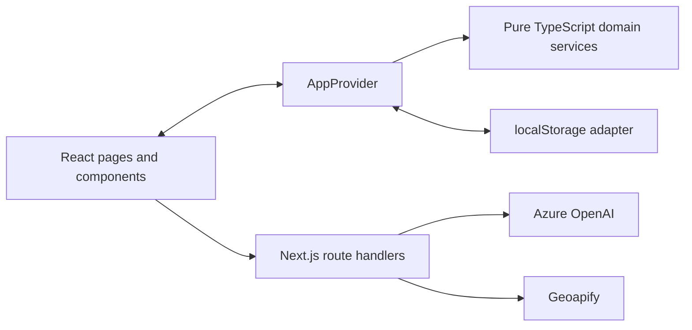

# SYMBIO — Technology Stack

SYMBIO is a B2B industrial by-product exchange built with Next.js and React. The current demo keeps application records in the browser and uses server routes for Azure OpenAI and Geoapify.

## At a glance

| Layer | Technology | Use in SYMBIO |
| --- | --- | --- |
| Framework | **Next.js 16.4.3** | App Router, route groups, layouts, server rendering and API route handlers |
| UI library | **React 19.3.0** | Interactive forms, dashboards, navigation, state and context |
| Language | **TypeScript 5**, strict mode | Domain models, validation, service contracts and typed components |
| Styling | **Tailwind CSS 4** | Responsive layouts, design tokens, utilities and component styling |
| CSS build integration | **@tailwindcss/turbopack** | Tailwind compilation through the configured Turbopack CSS loader |
| Motion | **Framer Motion 14** | Page entrances, drawers, assistant panel and animated statistics |
| Icons | **Lucide React** | Navigation, material categories, workflow and status icons |
| Charts | **Recharts 3** | Monthly bars, environmental trends and category donuts |
| Fonts | **Cormorant Garamond + Manrope** | Serif display headings and sans-serif body text through `next/font` |
| Browser persistence | **localStorage** | Companies, accounts, listings, requirements, negotiations and saved listings |
| Password hashing | **Web Crypto / PBKDF2-SHA256** | Salted hashes for the browser-local demo accounts |
| AI | **Azure OpenAI**, configured `gpt-4o` deployment | Material photo classification, catalogue-grounded assistance and upcycling/barter estimates |
| Geospatial services | **Geoapify** | Worldwide place search, static maps and driving routes |
| HTTP | Native **fetch** | Same-origin API calls and server-to-provider requests; no provider SDK needed |
| Hosting | **Vercel** | Next.js deployment and server-only environment settings |
| Package manager | **pnpm** | Reproducible dependency installation through `pnpm-lock.yaml` |
| Quality checks | **ESLint 9**, TypeScript, Node `assert` | Linting, type checking and executable domain regression checks |

Versions above describe the declared dependencies in [`package.json`](package.json). The lockfile records the resolved dependency versions. The package manager declaration is `pnpm@11.25.0`.

## Application structure



- `src/app/(marketing)`: home, about and contact pages.
- `src/app/(auth)`: registration, login and password-reset demonstration.
- `src/app/(app)`: dashboard, marketplace, matching, negotiations, barter, maps, impact and company settings.
- `src/components`: shared UI, forms, layout, charts, location search and providers.
- `src/services`: framework-independent business rules, types, validators, matching, impact and persistence.
- `src/server`: server-only external-service adapters.
- `src/app/api`: HTTP endpoints used by the browser.
- `src/lib` and `/prototype`: the original prototype, isolated from the current platform’s domain state.

## Feature implementation

### Matching and impact

The match engine uses deterministic TypeScript rather than an LLM. It first applies eligibility gates, then ranks material compatibility (40%), quantity coverage (25%), proximity (25%) and price (10%). Distance uses the Haversine formula and the coordinates stored with a selected location. Legacy demo records resolve their original city IDs through the seed catalogue.

Impact is derived from completed exchanges using material-specific illustrative factors. Recharts presents the results. These factors are invented demo values, not certified carbon accounting.

### Locations and maps

The reusable `LocationPicker` searches Geoapify through `/api/geo/geocode` and lets the user choose a result. The selected label and coordinates are saved with companies, listings and requirements. The map accepts the same worldwide search and filters companies using those coordinates. The original cities remain only as locations for seeded demo records.

Geoapify static map images and road routes are proxied through `/api/geo/staticmap` and `/api/geo/route`. The key stays on the server. If map images are unavailable, an SVG schematic fits itself to the current markers.

### AI integration

All AI requests use the server adapter in `src/server/azure-openai.ts`:

| Endpoint | Responsibility |
| --- | --- |
| `POST /api/ai/assistant` | Short answers grounded in the material catalogue and current demo marketplace context |
| `POST /api/ai/classify` | Image-based material suggestion, confidence and notes; user confirmation remains necessary |
| `POST /api/ai/barter` | Structured process classification, yield, Material Value Equivalency and risk estimates |

Classification images are resized with browser APIs. AI results are parsed/validated before display. The assistant falls back to labelled catalogue guidance if its service cannot be reached. The classifier and barter estimator display an unavailable state rather than inventing an AI result.

### Data and account model

`AppProvider` is the current application’s state owner. Pure service actions validate changes, and the storage adapter saves schema-versioned records to `symbio-app-v2` after hydration. Custom locations are embedded in the records so they survive reloads without an external location registry. Existing records without embedded locations remain compatible.

There is **no shared application database or production authentication service**. Password hashing does not turn browser-local state into server-enforced access control. Payments, verification and password-reset delivery are demonstrations. Contact messages use a separate local storage key; they are not delivered by email.

## Environment configuration

| Variable | Required for |
| --- | --- |
| `GEOAPIFY_API_KEY` | Place search, maps and routes |
| `AZURE_OPENAI_API_KEY` | All Azure OpenAI requests |
| `AZURE_OPENAI_ENDPOINT` | Azure resource or full chat-completions URL |
| `AZURE_OPENAI_DEPLOYMENT` | Deployment selection when building the URL; default `gpt-4o` |
| `AZURE_OPENAI_API_VERSION` | API version when building the URL; default `2025-01-01-preview` |

Use `.env.local` locally and Vercel environment settings for deployment. Secret variables have no `NEXT_PUBLIC_` prefix and must never be committed. `/api/status` exposes only configuration flags and descriptions, not key values; it is not an upstream health check.

## Development and validation

```bash
pnpm install --frozen-lockfile
pnpm dev

pnpm lint
pnpm typecheck
pnpm check:platform
pnpm check:foundation
pnpm build
```

The platform suite covers domain validation, matching, custom-location persistence and distances, exchange transitions, simulated payment state, impact arithmetic and credential hashing. The foundation suite protects the original prototype.

For local setup, the end-to-end demo and current boundaries, see the [README](README.md). Deployment instructions are in [docs/deployment.md](docs/deployment.md).
